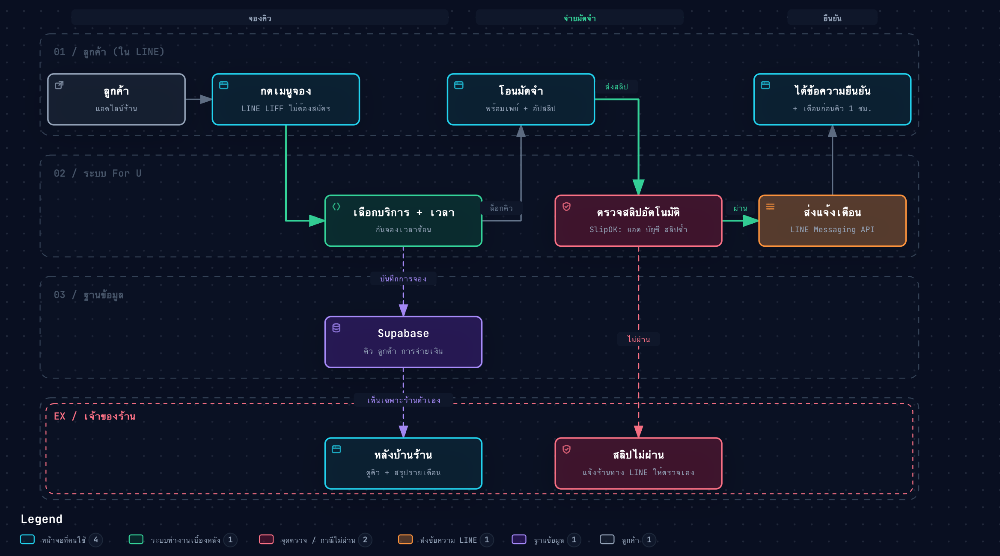

# For U: LINE booking and deposit system

A booking system for small service shops (nail salons, barbers) in Thailand. Customers book inside the shop's LINE Official Account, pick a free time slot, pay a deposit by PromptPay and upload the slip. The shop manages everything from a back office page.

This repository is a public showcase of the code. The production version runs for a real nail salon; here every shop-specific value (name, Supabase project, LINE IDs, payment QR, images) is replaced with a demo shop called **Demo Nails**.



## What it does

**Customers**
- Book from the LINE chat menu through LIFF, signed in with their LINE account
- See only open slots; a slot is held for a few minutes while they pay
- Pay the deposit by PromptPay QR and upload the slip
- Get a LINE confirmation and a reminder before the appointment
- Reschedule or cancel under the shop's rules

**Shop owner**
- Calendar of bookings, open and close days, holidays and special slots
- Booking notifications on LINE, plus a monthly summary
- LINE inbox: see customer chats, reply to many customers at once, send templates
- Promotions: referral codes, a lucky wheel after payment, partner coupons
- Booking links tagged by source (`?ref=`) to see which channel brings customers

## How it is built

| Part | Tech |
|---|---|
| Customer booking page | `web/index.html`, plain HTML, CSS and JavaScript, LINE LIFF SDK |
| Back office | `web/merchant.html` |
| Database | Supabase (PostgreSQL) with Row Level Security, RPC functions and triggers |
| Server logic | Supabase Edge Functions in TypeScript (Deno): booking, slip check, cancel, reschedule, LINE webhook, notifications, promotions |
| Scheduled jobs | `pg_cron` + `pg_net` for reminders and the monthly summary |
| Slip check | SlipOK API: amount, receiver account and duplicate transfer reference |

### Design choices worth a look
- **No double booking at the database level.** Slot holds and bookings are guarded by constraints and RPC functions, not only by the page (`supabase/schema.sql`, `supabase/migrations/`).
- **Each customer sees only their own data.** Row Level Security policies, tested in `supabase/tests/rls.sql`.
- **One slip pays one booking.** The transfer reference is unique, so the same slip can't be reused.
- **Slip check retries.** If the bank or SlipOK is slow, the check runs again every 10 minutes, up to 3 times, before the owner is alerted on LINE.
- **Secrets stay out of the code.** LINE tokens, SlipOK keys and cron secrets live in Supabase function environment variables and Vault.

## Project layout

```
web/                 booking page, back office, front-end modules, demo-config.js
supabase/schema.sql  full schema, policies and functions
supabase/migrations/ changes in order
supabase/functions/  Edge Functions (TypeScript)
supabase/tests/      SQL tests for policies and promotions
tests/               JavaScript and Python tests for the front end and contracts
```

## Running the tests

Requires Node.js and Python 3.

```bash
./run-tests.sh
```

The 38 tests check the front-end modules (slot status, LINE linking, promotions, reschedule rules, realtime updates) and contract rules between the pages, the database and the Edge Functions.

## Setting up a shop

1. Create a Supabase project and run `supabase/schema.sql`, then the files in `supabase/migrations/`.
2. Deploy the Edge Functions with the Supabase CLI and set their secrets (LINE channel token, SlipOK key, cron secret).
3. Fill in `web/demo-config.js` with the project URL, publishable key, LIFF ID, shop name, deposit and slot times.
4. Host the `web/` folder on any static host (the live shops use Netlify).

## How it was made

Built by Patapee Srigittayawat with AI coding tools (Claude Code, Codex). Requirements came from talking with shop owners; every change was tested before release, with automated tests on the parts that handle money and time.

Portfolio: https://ptdp-portfolio.netlify.app
